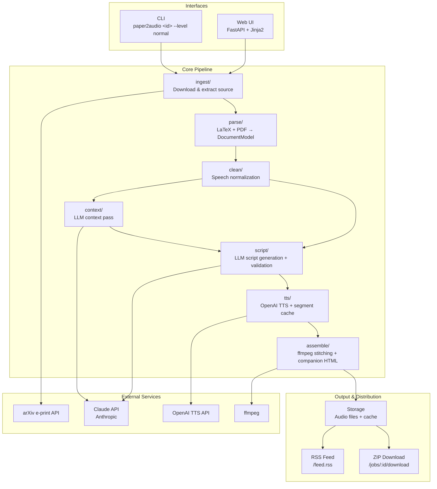

# System Architecture

## Overview

paper2audio is a pipeline service that converts research papers into produced audiobooks. Two distinct voices narrate the paper: one reads the original text verbatim, a second acts as a teacher — adding explanations, narrating figures, and translating equations. The output is a chaptered `.m4b` audiobook, an `.mp3` fallback, a companion HTML file, and an RSS feed that pushes every processed paper as a podcast episode to any podcast app.

The architecture is built around discrete, cacheable stages. Each stage has a clear input/output contract and writes its result to disk before the next stage starts. This makes runs resumable — a failure mid-TTS picks up from cached audio, not from scratch.

---

## Component Diagram



---

## Module Responsibilities

| Module | Responsibility |
|--------|---------------|
| `ingest/` | Download arXiv LaTeX tarball or accept a PDF upload; return raw bytes |
| `parse/` | LaTeX → DocumentModel; PDF fallback via marker-pdf → DocumentModel |
| `clean/` | Strip citations, resolve `\ref`/`\cite`, normalize text for speech, exclude references section |
| `context/` | Single LLM call over the full paper: glossary, main contributions, per-figure descriptions |
| `script/` | Per-section LLM calls returning ordered segment lists; chunk coverage validator; retry logic |
| `tts/` | TTS provider interface + OpenAI backend; per-segment audio cache keyed by content hash |
| `assemble/` | ffmpeg stitching with pauses and chimes, chapter markers, loudness normalization, companion HTML, RSS update |
| `web/` | FastAPI: job submission, SSE progress stream, download endpoint, RSS feed, static UI |
| `config.py` | Pydantic-settings: `config.yaml` + `.env`; single source of truth for all tunables |
| `cli.py` | CLI entry point wrapping the same pipeline |

---

## External Dependencies

| Service | Used for | Config key | Swappable |
|---------|----------|------------|-----------|
| arXiv e-print API | Download LaTeX source tarball | — | — |
| Claude API (Anthropic) | Context pass + script generation | `llm.model` | Model name only |
| OpenAI TTS API | Audio synthesis | `tts.provider: openai` | Via TTS interface |
| ffmpeg | Audio stitching, m4b encoding, loudness normalization | `ffmpeg.path` | — |

---

## Directory Structure

```
paper2audio/
├── paper2audio/
│   ├── __init__.py
│   ├── config.py          # Settings loader
│   ├── cli.py             # CLI entry point
│   ├── ingest/
│   │   ├── arxiv.py       # arXiv tarball download
│   │   └── pdf.py         # PDF upload handler
│   ├── parse/
│   │   ├── latex.py       # LaTeX → DocumentModel
│   │   ├── pdf.py         # marker-pdf → DocumentModel
│   │   └── models.py      # DocumentModel, Chunk, Figure, Equation, Section
│   ├── clean/
│   │   └── speech.py      # Citation removal, ref resolution, normalization
│   ├── context/
│   │   └── context.py     # LLM context pass, ContextCache model
│   ├── script/
│   │   ├── generate.py    # Per-section LLM calls
│   │   ├── validate.py    # Chunk coverage validator
│   │   └── models.py      # Segment union types (ReadSegment, ExplainSegment, …)
│   ├── tts/
│   │   ├── interface.py   # TTSProvider abstract base
│   │   ├── openai.py      # OpenAI TTS backend
│   │   └── cache.py       # Segment audio cache
│   ├── assemble/
│   │   ├── audio.py       # ffmpeg stitching + chapter markers
│   │   ├── html.py        # Companion HTML generator
│   │   └── rss.py         # RSS feed builder
│   └── web/
│       ├── app.py         # FastAPI app + routes
│       ├── jobs.py        # Background job runner + SSE progress
│       └── templates/
│           └── index.html
├── tests/
│   ├── test_clean.py
│   ├── test_validate.py
│   └── test_assemble.py
├── docs/
├── config.yaml
├── .env.example
├── pyproject.toml
├── Dockerfile
└── README.md
```

---

## Key Design Decisions

**Single DocumentModel for all input types.** Both the LaTeX and PDF parsers produce the same `DocumentModel`. Everything downstream is format-agnostic.

**LLM never writes paper text.** The script LLM returns chunk IDs for `read` segments, not the text itself. The original text is inserted by ID at render time. This eliminates hallucination of paper content and makes the coverage validator straightforward.

**Cache before proceeding.** Every stage persists its output before returning. The pipeline runner checks the cache at the start of each stage and skips if present.

**Single config.yaml.** All tunables — model name, TTS provider, explanation level defaults, pause durations, ffmpeg path — live in one file. API keys come from `.env` only.
