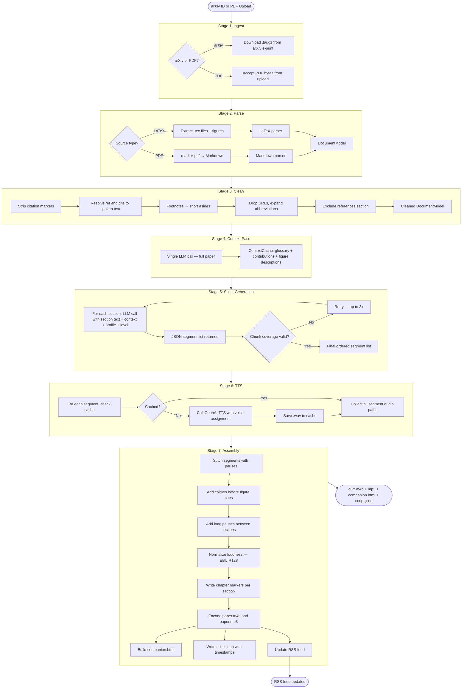
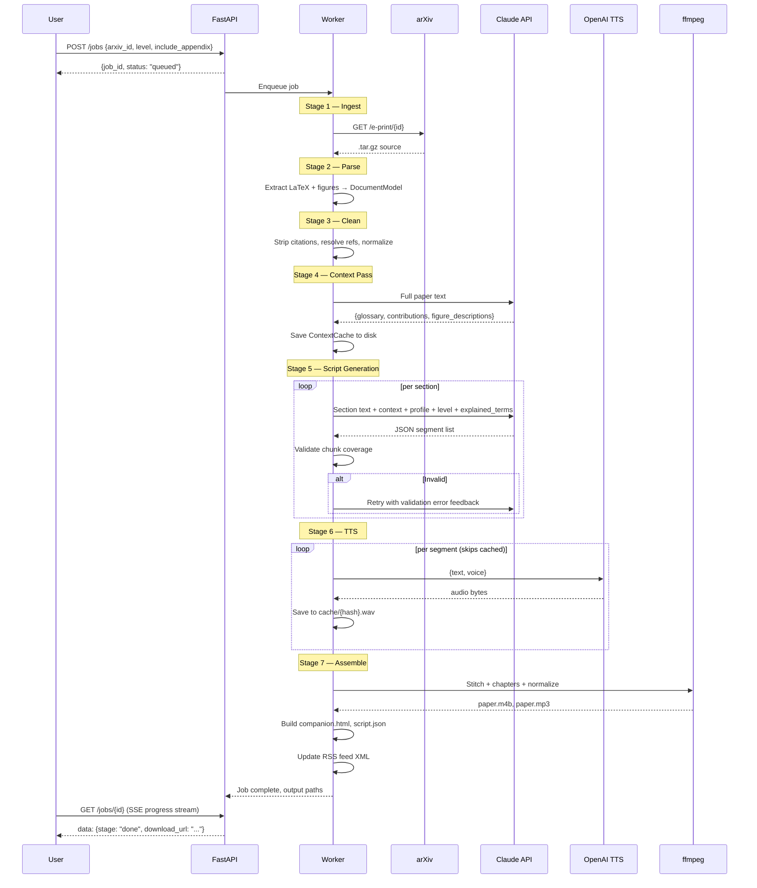

# Pipeline Design

## Full Data Flow



---

## Processing Sequence



---

## Stage Details

### Stage 1 — Ingest

**Input:** arXiv ID string (e.g. `1706.03762`) or PDF bytes  
**Output:** Raw source bytes on disk (`cache/raw/<id>/`)  
**Cache key:** arXiv ID or SHA256 of PDF bytes

arXiv LaTeX source is downloaded as a `.tar.gz` from `https://arxiv.org/e-print/<id>`. The tarball is extracted and the main `.tex` file is identified by scanning for `\documentclass`. Figures are extracted as image files and indexed by their filename.

PDF fallback uses `marker-pdf` to convert to structured Markdown, which the PDF parser then processes into a DocumentModel.

---

### Stage 2 — Parse

**Input:** Extracted LaTeX files or Markdown (from marker-pdf)  
**Output:** `DocumentModel` serialized to `cache/parsed/<id>.json`  
**Cache key:** Hash of raw source content

The LaTeX parser walks the AST to extract:
- Sections and their hierarchy (`\section`, `\subsection`, `\subsubsection`)
- Text split into sentence-level chunks (globally numbered from 0)
- Figure environments (`\begin{figure}`) with label, caption, image path
- Equation environments with label and LaTeX source
- Footnotes as separate text nodes

The references section (`\section*{References}`, `\bibliography{...}`) is excluded at parse time.

Both parsers must produce identical DocumentModel structure. The PDF path produces lower-fidelity output (no raw LaTeX for equations) but is structurally compatible.

---

### Stage 3 — Clean

**Input:** `DocumentModel`  
**Output:** `DocumentModel` with cleaned text fields (`cache/cleaned/<id>.json`)  
**Cache key:** Hash of parsed model

Transformations applied to every chunk's text:

| Transform | Rule |
|-----------|------|
| Citation removal | Strip `[12]`, `(Smith et al., 2021)`, `\cite{...}` |
| Ref resolution | `\ref{fig:arch}` → "Figure 3", `\ref{sec:method}` → "Section 4" |
| URL removal | Drop `http://...` and `https://...` links |
| Abbreviation expansion | `e.g.` → "for example", `i.e.` → "that is", `et al.` → "and colleagues" |
| Footnote handling | Move footnote text to a separate `explain` chunk appended after the paragraph |
| Equation placeholder | Inline `$...$` → "the expression" or spoken form for simple cases |
| Hyphen normalization | Em dashes and double-hyphens → ", " for natural speech rhythm |

---

### Stage 4 — Context Pass

**Input:** Full cleaned DocumentModel  
**Output:** `ContextCache` JSON (`cache/context/<id>.json`)  
**Cache key:** Hash of cleaned model

A single LLM call with the entire paper (title, abstract, all section text). The prompt asks for:

```json
{
  "glossary": {
    "term": "one-sentence plain-language definition"
  },
  "main_contributions": ["...", "..."],
  "figure_descriptions": {
    "fig1": "what this figure is actually showing, in 2 sentences"
  },
  "paper_difficulty": "introductory | standard | dense"
}
```

This output is passed to every Script Generation call. It ensures the explainer voice describes figures accurately and explains terms consistently across sections.

---

### Stage 5 — Script Generation

**Input:** Cleaned section text + ContextCache + user profile + explanation level + set of already-explained terms  
**Output:** Ordered `List[Segment]` per section, validated (`cache/script/<id>/<section_id>.json`)  
**Cache key:** Hash of section content + context + level

One LLM call per section. The model receives:
- The section's chunks with their IDs
- The ContextCache
- The user's `profile.md`
- The explanation level (`light` / `normal` / `heavy`)
- A set of terms already explained in earlier sections (to avoid repetition)

The model returns a flat ordered list of segments. The validator (see [Validation](#validation--chunk-coverage)) checks correctness before accepting the result. Up to 3 retries with the validation error message appended to the prompt.

The explainer voice is instructed to write as a knowledgeable teacher: direct, specific, never restating the paper's words.

---

### Stage 6 — TTS

**Input:** Ordered segment list  
**Output:** Per-segment `.wav` files  
**Cache key:** SHA256 of `text + voice_id`

Voice assignment:
- `read` segments → Voice A (neutral, clear narrator)
- `explain`, `figure_cue`, `equation` segments → Voice B (warmer, conversational)

Each segment is synthesized independently and cached. Re-runs only synthesize segments not already on disk. The TTS provider is behind an abstract interface so OpenAI TTS, ElevenLabs, or Kokoro can be swapped via `config.yaml`.

---

### Stage 7 — Assembly

**Input:** Ordered segment list with audio paths  
**Output:** `paper.m4b`, `paper.mp3`, `companion.html`, `script.json`

Assembly steps in order:

1. Concatenate segment audio files with ffmpeg, inserting:
   - 300ms pause between consecutive `read` segments
   - 600ms pause before/after `explain` segments
   - Soft chime (included asset) + 800ms pause before `figure_cue` segments
   - 1500ms pause between sections
2. Normalize loudness to EBU R128 (`-23 LUFS`)
3. Write chapter markers (one per top-level section) into the m4b container
4. Encode to `.m4b` (AAC, 64kbps) and `.mp3` (128kbps)
5. Build `companion.html` with timestamps, figures, and styled script (see [API Design](./04-api-design.md))
6. Write `script.json` with per-segment start/end timestamps
7. Append the paper to `outputs/feed.xml` (RSS feed)

---

## Caching Strategy

| Stage | Cache location | Cache key |
|-------|---------------|-----------|
| Ingest | `cache/raw/<id>/` | arXiv ID or PDF hash |
| Parse | `cache/parsed/<id>.json` | Hash of raw source |
| Clean | `cache/cleaned/<id>.json` | Hash of parsed model |
| Context | `cache/context/<id>.json` | Hash of cleaned model |
| Script | `cache/script/<id>/<section>.json` | Hash of section + context + level |
| TTS | `cache/audio/<hash>.wav` | SHA256 of text + voice |
| Final output | `outputs/<id>/` | — |

---

## Validation — Chunk Coverage

After script generation for each section, the following invariants are enforced:

1. **Complete coverage:** every chunk ID in the section appears in at least one `read` segment
2. **No duplication:** no chunk ID appears more than once across all `read` segments
3. **Ordering:** chunk IDs within a `read` segment are consecutive and appear in document order
4. **No out-of-section references:** chunk IDs belong to the current section only

If any invariant fails, the validator formats a structured error message and the section is re-generated. After 3 failed attempts the job halts with a detailed error report naming the section and the specific failure.

This is the hardest guarantee in the system — no chunk of the paper is ever skipped or read twice.
