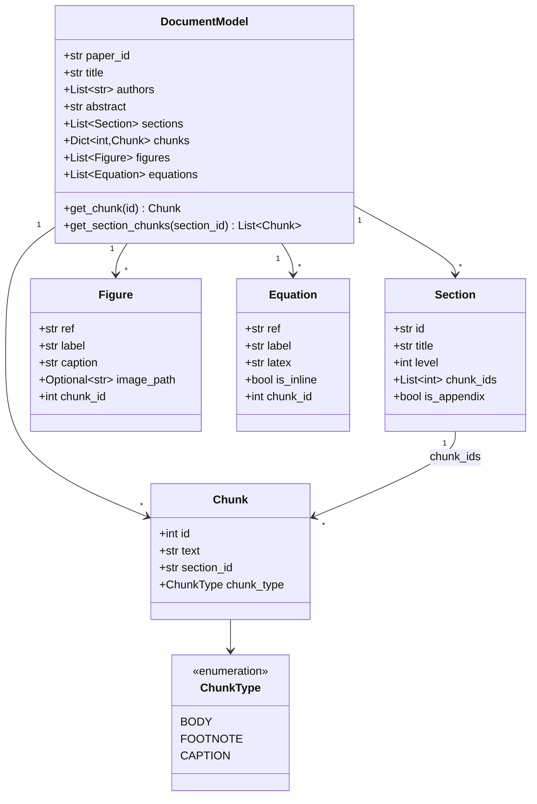
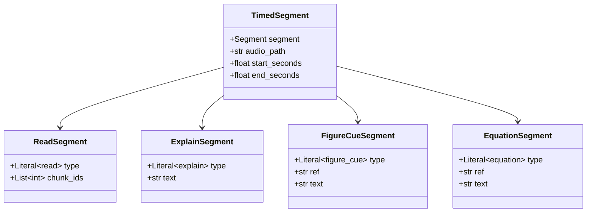

# Data Models

## DocumentModel

The `DocumentModel` is the unified intermediate representation produced by both the LaTeX and PDF parsers. Everything downstream operates on this model — the parsers are the only components that know about the source format.



**Key design notes:**
- Chunks are numbered globally (not per-section), starting from 0. This makes the coverage validator simple and unambiguous.
- `Figure` and `Equation` each reference the `chunk_id` of the sentence that first cites them, so the script generator knows where to place cues.
- The `references` section is excluded at parse time and never appears in the model.
- Appendix sections are parsed only when `include_appendix=True` in job options.

---

## ContextCache

Produced by a single LLM call over the full paper. Cached to disk and passed to every script generation call.

```python
class ContextCache(BaseModel):
    paper_id: str
    glossary: dict[str, str]           # term → plain-language definition
    main_contributions: list[str]       # 3–5 bullet points
    figure_descriptions: dict[str, str] # ref → 2-sentence description
    paper_difficulty: Literal["introductory", "standard", "dense"]
```

---

## Segment Types

The script generator returns an ordered flat list of these segments. This list drives both TTS and assembly.



**Discriminated union in Pydantic:**
```python
Segment = Annotated[
    ReadSegment | ExplainSegment | FigureCueSegment | EquationSegment,
    Field(discriminator="type")
]
```

**Example script.json excerpt:**
```json
[
  {"type": "read", "chunk_ids": [40, 41, 42]},
  {"type": "explain", "text": "Self-attention here means each token looks at every other token in the sequence simultaneously, rather than passing information step by step like an RNN."},
  {"type": "read", "chunk_ids": [43, 44]},
  {"type": "figure_cue", "ref": "fig1", "text": "Take a look at Figure 1 now. It shows the full Transformer architecture — encoder on the left, decoder on the right, with the attention layers stacked in the middle."},
  {"type": "read", "chunk_ids": [45, 46, 47]},
  {"type": "equation", "ref": "eq1", "text": "This is the scaled dot-product attention formula. The key idea is dividing by the square root of the key dimension to keep the dot products from getting too large before the softmax."}
]
```

---

## Job Model

```python
class JobStatus(str, Enum):
    QUEUED = "queued"
    INGESTING = "ingesting"
    PARSING = "parsing"
    CLEANING = "cleaning"
    CONTEXT = "context"
    SCRIPTING = "scripting"
    TTS = "tts"
    ASSEMBLING = "assembling"
    DONE = "done"
    FAILED = "failed"

class Job(BaseModel):
    id: str                            # UUID
    arxiv_id: Optional[str]
    level: Literal["light", "normal", "heavy"]
    include_appendix: bool
    status: JobStatus
    stage_progress: dict[str, float]   # stage → 0.0–1.0
    paper_title: Optional[str]
    duration_seconds: Optional[float]
    created_at: datetime
    completed_at: Optional[datetime]
    download_url: Optional[str]
    error: Optional[str]
```

**SSE progress event format:**
```json
{
  "job_id": "abc123",
  "status": "scripting",
  "stage_progress": {
    "ingesting": 1.0,
    "parsing": 1.0,
    "cleaning": 1.0,
    "context": 1.0,
    "scripting": 0.4
  },
  "message": "Generating script for Section 3 of 8"
}
```

---

## Config Schema

All settings live in `config.yaml`. API keys come from `.env` only.

```yaml
llm:
  model: claude-opus-4-5          # any Anthropic model ID
  max_retries: 3
  context_model: claude-opus-4-5  # can use a cheaper model for context pass

tts:
  provider: openai                # openai | elevenlabs | kokoro
  openai:
    voice_read: alloy             # narrator voice
    voice_explain: nova           # teacher voice
    speed: 1.0

defaults:
  level: normal                   # light | normal | heavy
  include_appendix: false

audio:
  pause_between_chunks_ms: 300
  pause_around_explain_ms: 600
  pause_before_figure_ms: 800
  pause_between_sections_ms: 1500
  output_format: m4b              # m4b | mp3 | both
  loudness_target_lufs: -23

cache:
  dir: ./cache
  outputs_dir: ./outputs

rss:
  title: "paper2audio"
  description: "Research papers as audiobooks"
  author: "paper2audio"

ffmpeg:
  path: ffmpeg                    # or absolute path
```
