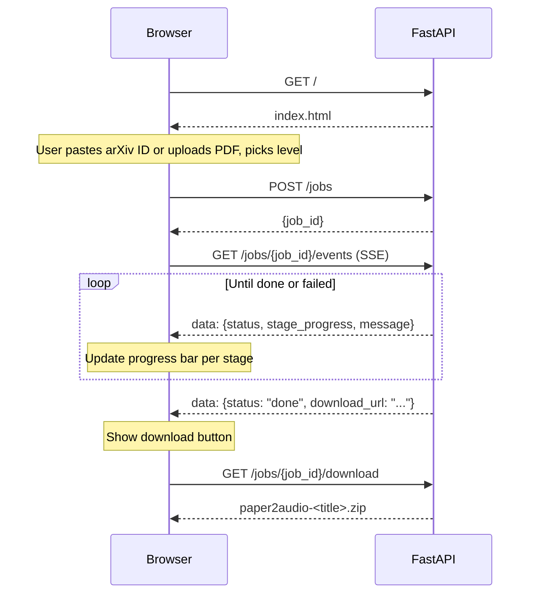

# API Design

## Endpoints

| Method | Path | Description |
|--------|------|-------------|
| `GET` | `/` | Web UI |
| `POST` | `/jobs` | Submit a new paper (arXiv ID or PDF upload) |
| `GET` | `/jobs/{job_id}` | Get job status |
| `GET` | `/jobs/{job_id}/events` | SSE stream of live progress |
| `GET` | `/jobs/{job_id}/download` | Download ZIP output |
| `GET` | `/audio/{job_id}/{filename}` | Serve individual audio file (for RSS) |
| `GET` | `/feed.rss` | RSS podcast feed |
| `GET` | `/health` | Health check |

---

## POST /jobs

Submit a paper for processing. Accepts either an arXiv ID or a PDF file upload.

**Request (arXiv ID):**
```json
{
  "arxiv_id": "1706.03762",
  "level": "normal",
  "include_appendix": false
}
```

**Request (PDF upload):** `multipart/form-data`
```
file: <pdf bytes>
level: normal
include_appendix: false
```

**Response `202 Accepted`:**
```json
{
  "job_id": "f3a2b1c0-...",
  "status": "queued",
  "created_at": "2026-11-25T10:00:00Z"
}
```

---

## GET /jobs/{job_id}

**Response `200 OK`:**
```json
{
  "id": "f3a2b1c0-...",
  "arxiv_id": "1706.03762",
  "level": "normal",
  "include_appendix": false,
  "status": "scripting",
  "stage_progress": {
    "ingesting": 1.0,
    "parsing": 1.0,
    "cleaning": 1.0,
    "context": 1.0,
    "scripting": 0.4,
    "tts": 0.0,
    "assembling": 0.0
  },
  "paper_title": "Attention Is All You Need",
  "duration_seconds": null,
  "created_at": "2026-11-25T10:00:00Z",
  "completed_at": null,
  "download_url": null,
  "error": null
}
```

---

## GET /jobs/{job_id}/events

Server-Sent Events stream. The client subscribes to this and updates the progress UI in real time.

**Event format:**
```
data: {"status": "scripting", "stage_progress": {"scripting": 0.6}, "message": "Generating script for Section 4 of 8"}

data: {"status": "tts", "stage_progress": {"tts": 0.0}, "message": "Starting TTS synthesis"}

data: {"status": "done", "download_url": "/jobs/f3a2b1c0/download", "duration_seconds": 10740}
```

Connection closes when status is `done` or `failed`.

---

## GET /feed.rss

Returns an RSS 2.0 feed with iTunes podcast namespace extensions. Subscribe to this URL in any podcast app.

**Response `200 OK` `Content-Type: application/rss+xml`:**
```xml
<?xml version="1.0" encoding="UTF-8"?>
<rss version="2.0"
  xmlns:itunes="http://www.itunes.com/dtds/podcast-1.0.dtd"
  xmlns:podcast="https://podcastindex.org/namespace/1.0">

  <channel>
    <title>paper2audio</title>
    <link>https://paper2audio.fly.dev</link>
    <description>Research papers as audiobooks</description>
    <language>en-us</language>
    <itunes:author>paper2audio</itunes:author>
    <itunes:category text="Education"/>

    <item>
      <title>Attention Is All You Need</title>
      <guid>1706.03762</guid>
      <pubDate>Tue, 25 Nov 2026 10:00:00 +0000</pubDate>
      <description>Vaswani et al. (2017). Processed at: normal explanation level.</description>
      <enclosure
        url="https://paper2audio.fly.dev/audio/f3a2b1c0/paper.mp3"
        type="audio/mpeg"
        length="92160000"/>
      <itunes:duration>02:33:14</itunes:duration>
      <itunes:explicit>no</itunes:explicit>
    </item>

  </channel>
</rss>
```

Each processed paper becomes a new `<item>`. The `.mp3` is served directly from the backend. Chapter markers in `.m4b` are available via the download ZIP.

---

## RSS Setup (one-time)

1. Deploy the backend to Fly.io (or any host)
2. Copy the URL `https://<your-app>.fly.dev/feed.rss`
3. Open Apple Podcasts → Library → Add a Show by URL → paste
4. Every new paper you process will appear as a new episode and download automatically

Works with: Apple Podcasts, Overcast, Pocket Casts, Spotify, Castro, any standard podcast app. No subscription required.

---

## Web UI Flow



The UI is a single HTML page — no JavaScript framework. One form, one progress display, one download button. No state to manage beyond the SSE stream.

---

## CLI Interface

```bash
# arXiv ID
paper2audio 1706.03762

# arXiv ID with options
paper2audio 1706.03762 --level heavy --include-appendix

# PDF file
paper2audio --pdf ./paper.pdf --level light

# Output to specific directory
paper2audio 1706.03762 --out ./my-audiobooks
```

The CLI runs the same pipeline as the web backend, writes outputs to `./outputs/<id>/` by default, and prints stage progress to stdout.

```
[1/7] Ingesting...        ✓
[2/7] Parsing...          ✓
[3/7] Cleaning...         ✓
[4/7] Context pass...     ✓
[5/7] Generating script...  Section 3/8
[6/7] TTS synthesis...    47/120 segments
[7/7] Assembling...       ✓

Done. Output: ./outputs/1706.03762/
  paper.m4b     (2h 33m)
  paper.mp3
  companion.html
  script.json
```
