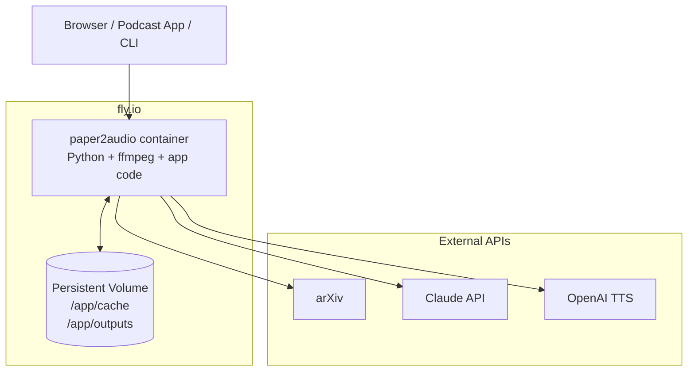

# Deployment

## Target: Fly.io

Fly.io is the deployment target. It runs Docker containers, supports persistent volumes (for the audio cache and outputs), handles SSL automatically, and is straightforward for a single-container personal app.

---

## Architecture on Fly.io



The backend is a single container. No separate database — the filesystem is the store. The persistent volume keeps the cache and outputs between deploys.

---

## Dockerfile

```dockerfile
FROM python:3.11-slim

# ffmpeg
RUN apt-get update && apt-get install -y ffmpeg && rm -rf /var/lib/apt/lists/*

WORKDIR /app

# Install uv
RUN pip install uv

# Dependencies
COPY pyproject.toml .
RUN uv sync --no-dev

# App code
COPY paper2audio/ ./paper2audio/
COPY config.yaml .

# Cache and outputs dirs (will be mounted as volume)
RUN mkdir -p /app/cache /app/outputs

EXPOSE 8000
CMD ["uv", "run", "uvicorn", "paper2audio.web.app:app", "--host", "0.0.0.0", "--port", "8000"]
```

---

## fly.toml

```toml
app = "paper2audio"
primary_region = "sjc"

[build]

[http_service]
  internal_port = 8000
  force_https = true
  auto_stop_machines = "stop"
  auto_start_machines = true
  min_machines_running = 0

[[mounts]]
  source = "paper2audio_data"
  destination = "/app/data"

[env]
  CACHE_DIR = "/app/data/cache"
  OUTPUTS_DIR = "/app/data/outputs"
```

`auto_stop_machines = "stop"` means the container sleeps when idle and cold-starts on the next request (takes ~2–3 seconds). Fine for a personal tool. Set to `"suspend"` for faster cold starts if needed.

---

## Environment Variables

Set these via `fly secrets set`:

```bash
fly secrets set ANTHROPIC_API_KEY=sk-ant-...
fly secrets set OPENAI_API_KEY=sk-...
```

Never committed to the repo. `.env.example` documents what's needed:

```bash
# .env.example
ANTHROPIC_API_KEY=
OPENAI_API_KEY=
```

---

## Persistent Volume

Create once:

```bash
fly volumes create paper2audio_data --size 10 --region sjc
```

10GB covers a lot of cached audio. Increase if needed. The cache means re-processing the same paper is nearly free — only new TTS segments get synthesized.

---

## Deploy

```bash
# First deploy
fly launch --no-deploy
fly secrets set ANTHROPIC_API_KEY=... OPENAI_API_KEY=...
fly deploy

# Subsequent deploys
fly deploy
```

---

## RSS Feed URL

After deploy, the RSS feed is at:

```
https://paper2audio.fly.dev/feed.rss
```

Add this URL to your podcast app once. All processed papers appear as episodes automatically.

---

## Cost Estimate (personal use)

| Item | Estimate |
|------|----------|
| Fly.io compute (auto-stop, ~1 paper/day) | ~$3–5/month |
| Fly.io volume (10GB) | ~$1.50/month |
| Claude API (context + script, per paper ~15k tokens) | ~$0.10–0.30/paper |
| OpenAI TTS (per paper ~40k chars) | ~$0.20–0.50/paper |
| **Total per paper** | ~$0.30–0.80 |

Caching makes re-runs of the same paper essentially free (only pays for stages that weren't cached).
